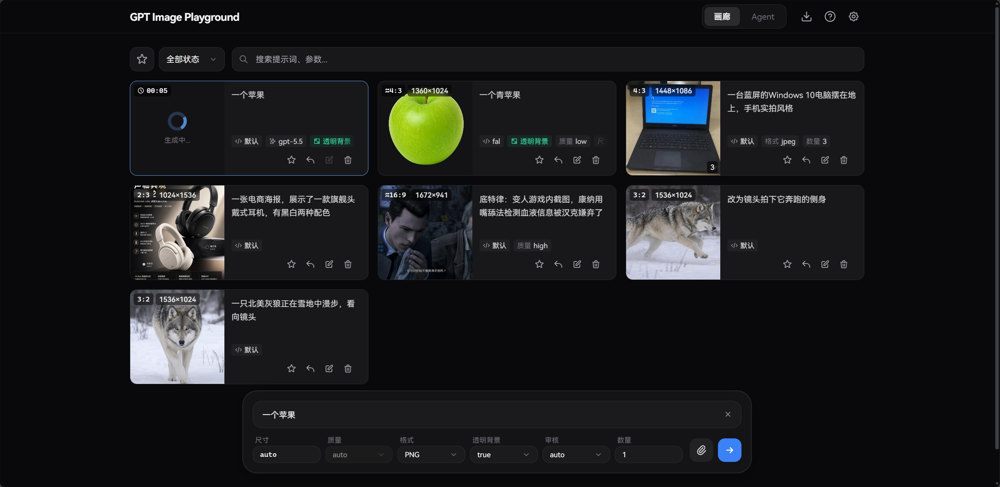
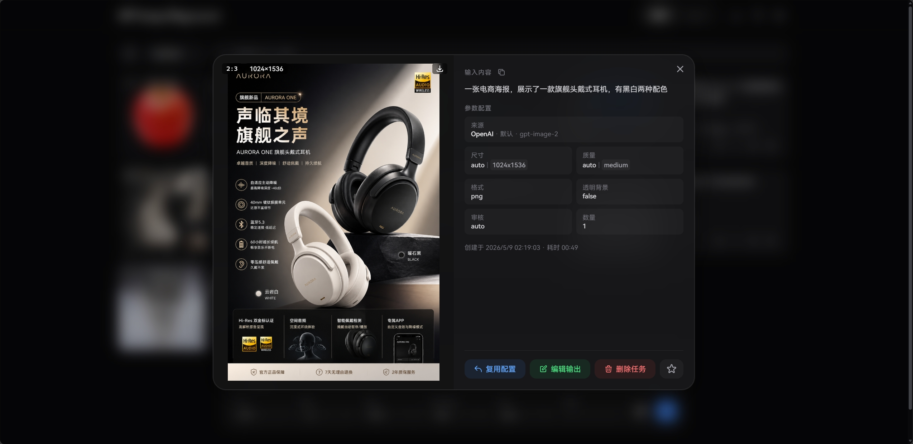
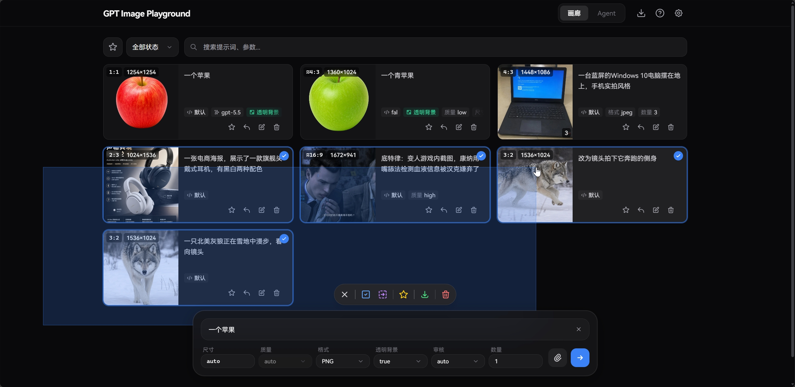
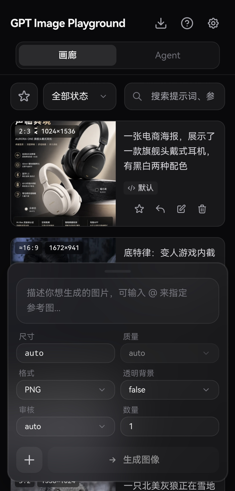
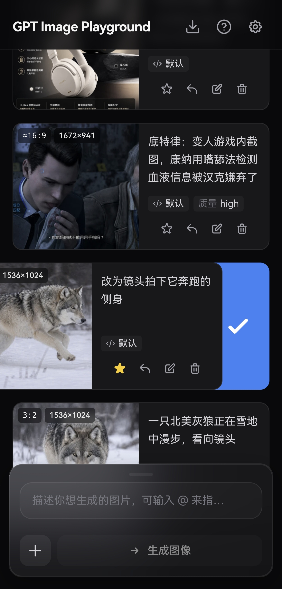

<div align="center">

# 🎨 GPT Image Playground

[](https://github.com/CookSleep/gpt_image_playground/stargazers)
[](https://github.com/CookSleep/gpt_image_playground/network/members)
[](https://github.com/CookSleep/gpt_image_playground/blob/main/LICENSE)
[](https://react.dev/)
[](https://www.typescriptlang.org/)

**基于 OpenAI gpt-image-2.5 API 的图片生成与编辑工具**

提供简洁精美的 Web UI，支持 OpenAI / OpenAI 兼容接口、sub2api（异步）、fal.ai 与可导入的自定义 HTTP 供应商。<br>
支持文本生图、参考图、画板标注与遮罩编辑，数据纯本地化存储，带来流畅的历史记录与参数管理体验。

<br>

[](https://gpt-image-playground.cooksleep.dev)
&nbsp;&nbsp;&nbsp;
[](https://cooksleep.github.io/gpt_image_playground)

</div>

<br>

> 💡 **提示**：Vercel 体验版使用 `.dev` 域名，受安全策略限制通常只能调用 HTTPS 接口。需要调用内网或本地 HTTP API 时，请使用 GitHub Pages 版本或自行部署。

---

## ❤️ 赞助商

<table>
<tr>
<td width="180" align="center" valign="middle">
  <a href="https://moyuu.cc/register?aff=z95r"></a>
</td>
<td valign="middle"><b><a href="https://moyuu.cc/register?aff=z95r">摸鱼 AI</a></b>&nbsp;，让 AI API 接入更简单。明码标价，充值 1:1，支持 GPT、Claude、Gemini 等主流模型，重新定义「便宜 · 稳定 · 高速」</td>
</tr>
<tr>
<td width="180" align="center" valign="middle">
  <a href="https://jucodex.com/register?aff=3JDW"></a>
</td>
<td valign="middle"><b><a href="https://jucodex.com/register?aff=3JDW">JuCodex</a></b>&nbsp;为企业级用户打造的高可用、低延迟、极致性价比的中转站，提供 Codex、Claude Code、Grok 等主流大模型中转服务，新用户注册送 3 元（QQ 邮箱），永久承诺 0 水 0 替、模型 100% 保真。<a href="https://image.jucodex.com">生图工作台</a></td>
</tr>
<tr>
<td width="180" align="center" valign="middle">
  <a href="https://go.apimart.ai/gh-gpt_image_playground"></a>
</td>
<td valign="middle"><b><a href="https://go.apimart.ai/gh-gpt_image_playground">APIMart</a></b>&nbsp;是专注 AI 图片/视频生成的低价 API 平台，GPT-Image-2 低至 $0.006/张，1 美元可出图 160+ 张。图片、视频一套异步 API 通吃，提交任务拿 ID、回调取结果，跑批万张不超时、换模型不改代码。按量付费、无月费，通过<a href="https://go.apimart.ai/gh-gpt_image_playground">此注册链接</a>注册即可开用。</td>
</tr>
<tr>
<td width="180" align="center" valign="middle">
  <a href="https://api.muteki.site/register?aff=CookSleep&promo=CookSleep"></a>
</td>
<td valign="middle"><b><a href="https://api.muteki.site/register?aff=CookSleep&promo=CookSleep">MaruCode</a></b>&nbsp;是一家偶尔做做慈善的小破站 API，自营号池，主要提供 OpenAI、Anthropic、GPT Image 等主流模型，支持 Websocket 协议，明码标价(OAI 0.3x, A÷ 1.7x)，透明汇率(1:1)，<a href="https://api.muteki.site/register?aff=CookSleep&promo=CookSleep">新用户注册送 1 刀</a>。<a href="https://images-2.muteki.site">生图工作台🖼️</a></td>
</tr>
<tr>
<td width="180" align="center" valign="middle">
  <a href="https://api.sublyx.org/register?aff=U62PAZERCHEA"></a>
</td>
<td valign="middle"><b><a href="https://api.sublyx.org/register?aff=U62PAZERCHEA">Sublyx</a></b>&nbsp;是一家稳定高效的 AI API 聚合网关，支持 OpenAI、Claude、Grok、Codex、gpt-image-2 等主流模型，兼容 OpenAI SDK、Claude Code、Codex、Cherry Studio 等常用工具。通过<a href="https://api.sublyx.org/register?aff=U62PAZERCHEA">链接注册</a>并使用优惠码 <code>IMG2</code>，可额外领取 10 刀额度。<a href="https://img2.icedit.ai">生图工作台</a></td>
</tr>
</table>

---

## 📸 界面预览

<details>
<summary><b>点击展开截图展示</b></summary>
<br>

<div align="center">
  <b>桌面端主界面</b><br>
  
</div>

<br>

<div align="center">
  <b>任务详情与实际参数</b><br>
  
</div>

<br>

<div align="center">
  <b>桌面端批量选择</b><br>
  
</div>

<br>

<div align="center">
  <b>桌面端 Agent 模式</b><br>
  
</div>

<br>

<div align="center">
  <b>移动端主界面</b><br>
  
</div>

<br>

<div align="center">
  <b>移动端侧滑多选</b><br>
  
</div>

</details>

---

## ✨ 核心特性

### 🎨 强大的图像生成与编辑
- **参考图与遮罩**：最多 16 张参考图（支持剪贴板和拖拽）；也可直接粘贴图片链接（http/https）作为参考图，外链会随图片记录保留，供只接受外链参考图的服务商使用。内置遮罩编辑器，自动预处理以符合官方分辨率限制。
- **画板标注**：在空白画布或参考图上用画笔、文字、图形和像素橡皮擦标注修改意图，完成后作为参考图；画板与遮罩编辑器可缩放平移（Alt / Ctrl + 滚轮、Alt + 拖动、双指捏合）。
- **评论标注**：在画板中用评论工具点击图片添加评论，以“@图N 评论”插入提示词，发送时附上评论在图中的位置（如 `(X=52%, Y=41%)`），复用任务时可恢复。
- **批量与迭代**：支持单次多图生成；一键将满意结果转为参考图，无缝开启下一轮修改。
- **多提示词批量提交**：在习惯配置中开启后，可一次粘贴多条提示词（以两个空行分隔），共用参考图和参数；支持排队或并发（默认上限 10），可随时查看进度或停止。
- **流式生成预览**：`Images API` 与 `Responses API` 模式均支持流式接收中间步骤图像，缓解连接超时问题。
- **透明背景**：画廊模式下选择 PNG 或 WebP 后可开启，可在 API 配置页为每个配置分别选择 API 原生或本地后处理。

  > - **API 原生**：直接请求模型返回透明通道，需接口和模型支持。接口返回“不支持透明背景”类错误时，应用会提示切换为本地后处理。
  > - **本地后处理**：要求模型使用纯绿或纯洋红背景，结果返回后在浏览器中去除背景色，按所选格式保存。适合图标、贴纸、单主体素材；主体有复杂发丝、半透明材质、强反光或颜色接近背景色时，边缘可能残留或误抠。

### 🤖 Agent 多轮对话模式
- **多轮对话与上下文记忆**：基于 Responses API，Agent 理解上下文并按需调用图像工具；可用 `@` 引用参考图或之前生成的图片，也会自动识别上下文中的图片。
- **并发批量生成**：`generate_image_batch` 在一轮中并发生成多张关联图像，`continue_generation` 自动追加新一轮以处理依赖关系。
- **分支与重新生成**：编辑重发或重新生成某轮消息会产生可切换的分支，图片引用只在当前分支内解析。
- **画廊同步与隔离删除**：Agent 生成的图片同步到画廊；删除对话默认保留画廊记录，删除画廊任务时自动清理对话中的图片引用。
- **可选 Web 搜索**：可开启 `web_search` 工具，Agent 会在需要时搜索网络信息并附带引用链接。

### ⚙️ 精细化参数追踪
- **智能尺寸控制**：提供 1K/2K/4K 预设，自定义宽高时自动规整到模型安全范围（16 的倍数、总像素校验等）。
- **实际参数对比**：提取 API 响应中实际生效的尺寸、质量、耗时和**模型改写后的提示词**，与请求参数高亮对比。

### 📁 高效历史管理 (纯本地)
- **瀑布流与画廊**：历史任务自动保存，支持按状态过滤、全屏大图预览与快捷下载。
- **多收藏夹管理**：同一任务可归入多个收藏夹；概览页显示封面和任务数，进入后可叠加搜索与状态筛选；支持拖拽排序、重命名、设为默认和按收藏夹打包下载 ZIP。
- **失败任务重试**：重试方式可选新建任务或覆盖原任务（不限失败任务）；覆盖时保留创建时间和收藏，耗时重新计算。
- **快捷批量操作**：桌面端支持拖拽框选、Ctrl/⌘ 连选，移动端支持侧滑多选，便于批量收藏与清理。
- **图片查看与下载**：大图预览支持左右滑动切换，移动端可长按弹出操作菜单，支持快捷下载与批量下载。
- **性能与隐私**：记录和图片只保存在本地（网页版为 IndexedDB，客户端为本机数据目录），SHA-256 去重压缩，不经过第三方服务器；可打包导出 ZIP 备份。

### 🔌 多配置与供应商增强
- **多配置管理**：保存多个 API 配置（供应商、API Key、模型等）并快速切换；可一键复制当前配置到列表底部，配置和供应商列表均可拖拽排序。
- **多模型切换**：模型 ID 可用逗号分隔填写多个（如 `gpt-image-2.5-sunburst, gpt-image-2`），在首页切换，按配置分别记住；预置配置、URL 传参与导入导出均支持此写法。
- **多供应商接入**：内置 OpenAI 兼容接口（`Images API` / `Responses API`）、sub2api（异步）、fal.ai（队列），并可通过 JSON 导入自定义 HTTP 供应商（同步/异步任务）。
- **Agent 模式独立 API 配置**：Agent 可使用原生（Responses API）或混合（Responses API + Images API）的独立配置，适配不支持 `image_generation` 工具的供应商或模型。
- **API 代理**：OpenAI 兼容接口与 fal.ai 均可配置自定义代理；OpenAI 兼容接口还可走同源 `/api-proxy/`，由 Docker 或本地开发服务器转发，绕开浏览器 CORS 限制。
- **Codex CLI 兼容模式**：上游为 Codex CLI 时，按其实际支持的参数发送请求，并把多图生成拆成并发单图。
- **提示词防改写**：Responses API 始终在请求前加入防改写指令；开启 Codex CLI 模式后，Images API 也会加入。
- **智能诊断提示**：检测到接口异常改写或缺少常规参数时，提示开启相应的兼容模式。
- **习惯配置**：提交后清空输入、重启后保留输入、临时复用历史任务的 API 配置、重试方式、关闭提示词防改写、界面字体、系统通知、自动检查更新等。
- **版本更新**：启动时检查新版本并展示更新说明；客户端可直接下载并安装更新。

---

## 🚀 部署与使用

Windows 用户可以直接安装桌面客户端；网页版可以部署到 Vercel、GitHub Pages、Cloudflare Workers、Docker 或任意静态文件服务器。

部署时可以通过环境变量 `VITE_DEFAULT_API_URL` 提供**预置配置**：部署端预先加入用户配置列表的 API 配置，格式与用户自建的配置相同，用户打开页面通常只需补充 API Key。

完整写法见 [预置配置](#preset-config)，其余变量见 [环境变量](#env-vars)。

仓库中的 GitHub Actions 工作流分别负责客户端、Vercel、GitHub Pages 和 Docker 镜像，不需要的可在 **Actions** 中选中对应工作流后停用（**Disable workflow**）。

<a id="desktop-client"></a>
<details>
<summary><strong>🖥️ 方式一：Windows 桌面客户端</strong></summary>

客户端的数据保存在本机，不受浏览器存储配额和跨域限制影响，可直连任意中转 API。

**安装**

- 在 [Releases](https://github.com/CookSleep/gpt_image_playground/releases/latest) 中下载以 `_x64-setup.exe` 结尾的安装包。
- 安装包没有代码签名，遇到 SmartScreen 提示时点击“更多信息 → 仍要运行”。
- 安装到普通文件夹（如 `D:\Apps\GPT Image Playground`）。装到 `C:\Program Files` 等需要管理员权限写入的位置会导致无法保存数据。
- 数据默认保存在 `<安装目录>\data` 中，可在“设置 → 数据管理”中更改。

**自行构建**

需要 Rust 和 Tauri 的 Windows 构建环境，见 [Tauri 前置条件](https://v2.tauri.app/start/prerequisites/)。

```bash
npm install
npm run tauri:dev
npm run tauri:build
```

- 客户端构建读取 [`src-tauri/.env`](src-tauri/.env)，不读取根目录的 `.env`；可在 `src-tauri/.env.local` 中覆盖。
- 客户端专用变量 `VITE_WEB_APP_URL`：复制导入链接时使用的网页版地址，未设置时改用 `gpt-image-playground://` 链接。
- `tauri:build` 需设置 `TAURI_SIGNING_PRIVATE_KEY`（私钥内容或路径）和 `TAURI_SIGNING_PRIVATE_KEY_PASSWORD`，用于给更新包签名。
- 自行分发时，用 `npx tauri signer generate` 生成自己的密钥，并替换 `src-tauri/tauri.conf.json` 中的 `plugins.updater.pubkey` 和更新地址。
- 推送 `v*` tag 时，若仓库 Secrets 配置了 `TAURI_SIGNING_PRIVATE_KEY`（及其密码），会先构建客户端并上传到 Release，成功后再部署网页版和 Docker 镜像；未配置则跳过客户端，直接部署。

</details>

<details>
<summary><strong>▲ 方式二：Vercel 一键部署（网页版推荐）</strong></summary>

**初始部署**

[](https://vercel.com/new/clone?repository-url=https%3A%2F%2Fgithub.com%2FCookSleep%2Fgpt_image_playground&project-name=gpt-image-playground&repository-name=gpt-image-playground)

点击按钮导入仓库，Vercel 会自动构建并部署。

**环境变量（可选）**

在 Vercel 项目的 **Settings → Environment Variables** 中添加，添加或修改后需要重新部署：

```dotenv
VITE_DEFAULT_API_URL=https://api.openai.com/v1
```

**绑定自定义域名（国内直连）**

Vercel 分配的 `.vercel.app` 域名在国内通常无法直接访问，可在 **Settings → Domains** 中绑定自己的域名。

**更新方式**

`vercel.json` 关闭了默认的自动部署。Fork 本仓库后，建议配置 Deploy Hook：

1. 在 Vercel 项目的 **Settings → Git → Deploy Hooks** 中创建名为 `Release` 的 Hook（Branch 填 `main`），复制生成的 URL。
2. 在 Fork 仓库的 **Settings → Secrets and variables → Actions** 中新建 Secret `VERCEL_DEPLOY_HOOK`，填入该 URL。

配置完成后：

- **自动更新**：本仓库发布正式版本（版本号变动）后，在 Fork 页面点击 **Sync fork** 会触发 Vercel 部署；普通提交不会触发。
- **手动触发**：在 **Actions** 中选择 **Deploy to Vercel**，对 `main` 分支执行 **Run workflow**，可立即部署最新代码（包括未发布的提交）。

</details>

<details>
<summary><strong>🌐 方式三：GitHub Pages 部署</strong></summary>

通过 GitHub Actions 工作流构建并发布到 GitHub Pages。

**环境变量（可选）**

在仓库 **Settings → Secrets and variables → Actions** 中，将 `VITE_DEFAULT_API_URL` 添加到 **Secrets**：

```dotenv
VITE_DEFAULT_API_URL=https://api.openai.com/v1
```

其他变量添加到 **Variables**，变量名与 [环境变量](#env-vars) 表一致。

**初始部署**

1. 在仓库 **Settings → Pages** 中，将 **Build and deployment → Source** 设为 **GitHub Actions**。
2. 在 **Actions** 中选择 **Deploy to GitHub Pages**，对 `main` 分支执行 **Run workflow**，完成首次部署。

**更新方式**

- **自动更新**：本仓库发布正式版本（版本号变动）后，在 Fork 页面点击 **Sync fork** 会自动构建并部署；普通提交不会触发。
- **手动触发**：同样执行 **Deploy to GitHub Pages** 工作流，可立即部署最新代码（包括未发布的提交）。

</details>

<details>
<summary><strong>☁️ 方式四：Cloudflare Workers 部署</strong></summary>

通过内置的 Wrangler 配置，将构建产物作为静态资源部署到 Cloudflare Workers。

**环境变量（可选）**

Cloudflare Workers 不会在部署后改写静态文件，变量必须在构建前设置（如写入项目根目录的 `.env.local`）：

```dotenv
VITE_DEFAULT_API_URL=https://api.openai.com/v1
```

**部署**

```bash
npx wrangler login
npm run deploy:cf
```

`deploy:cf` 会先执行 `npm run build`，再通过 `wrangler deploy` 上传 `dist/` 目录。

</details>

<a id="docker-deployment"></a>
<details>
<summary><strong>🐳 方式五：Docker 部署</strong></summary>

使用官方镜像在服务器或本地容器环境中运行。

**Docker CLI**

```bash
docker run -d -p 8080:80 \
  -e DEFAULT_API_URL=https://api.openai.com/v1 \
  ghcr.io/cooksleep/gpt_image_playground:latest
```

使用 host 网络时加 `--network host`，修改监听端口用 `-e PORT=28080`。

**Docker Compose**

```yaml
services:
  gpt-image-playground:
    image: ghcr.io/cooksleep/gpt_image_playground:latest
    environment:
      - DEFAULT_API_URL=https://api.openai.com/v1
    ports:
      - "8080:80"
    restart: unless-stopped
```

**挂载配置文件**

`DEFAULT_API_URL` 指向容器内路径时，宿主机上的 JSON 配置文件需通过 volume 挂载：

```bash
docker run -d -p 8080:80 \
  -v ./gpt-image-config.json:/config/gpt-image-config.json:ro \
  -e DEFAULT_API_URL=/config/gpt-image-config.json \
  ghcr.io/cooksleep/gpt_image_playground:latest
```

**Docker 专属变量**

| 变量 | 说明 |
|------|------|
| `ENABLE_API_PROXY=true` | 开启 Nginx 同源代理，请求发往 `/api-proxy/{路径}` 再转发到 `API_PROXY_URL` |
| `API_PROXY_URL` | 代理转发的完整 API 基础地址（不自动补 `/v1`） |
| `LOCK_API_PROXY=true` | 强制开启代理，用户无法关闭；需同时设置 `ENABLE_API_PROXY=true` |
| `HOST` / `PORT` | Nginx 监听地址和端口，默认 `0.0.0.0:80` |

> 开启 API 代理后，任何人都能将你的服务器作为代理来请求目标 API。建议仅在有访问控制（如 IP 白名单）或本地网络中开启。

> 旧版 `API_URL` 已拆分为 `DEFAULT_API_URL` 和 `API_PROXY_URL`，容器启动时自动兼容，无需立即修改。

**隐藏真实 API 地址**

同时开启 `ENABLE_API_PROXY` 和 `LOCK_API_PROXY`，真实地址只写在 `API_PROXY_URL` 中：

- OpenAI 兼容接口：`DEFAULT_API_URL` 留空或填占位地址（如 `https://proxy`）。
- 自定义供应商：预置 JSON 中的 `baseUrl` 留空并设置 `apiProxy: true`（仅支持同步配置）。

```bash
docker run -d -p 8080:80 \
  -e DEFAULT_API_URL= \
  -e API_PROXY_URL=https://real-api.example.com/v1 \
  -e ENABLE_API_PROXY=true \
  -e LOCK_API_PROXY=true \
  ghcr.io/cooksleep/gpt_image_playground:latest
```

**更新方式**

使用 `latest` 标签时，重新拉取镜像并重启即可（如 `docker compose pull && docker compose up -d`）。需要固定版本时使用版本号标签（如 `0.2.x`）。

</details>

<details>
<summary><strong>💻 方式六：本地开发与静态构建</strong></summary>

**1. 环境变量（可选）**

在项目根目录新建 `.env.local`：

```dotenv
VITE_DEFAULT_API_URL=https://api.openai.com/v1
```

**2. 安装依赖并启动**

```bash
npm install
npm run dev
```

**3. 本地开发跨域代理（可选）**

本地开发遇到浏览器 CORS 限制时，可开启开发服务器代理：

```bash
cp dev-proxy.config.example.json dev-proxy.config.json
```

- 将 `dev-proxy.config.json` 中的 `target` 设为完整的 API 基础地址。代理不会自动补 `/v1`，OpenAI 兼容接口通常要写到版本前缀，如 `https://api.example.com/v1`。
- 重启开发服务器，在设置中开启 **API 代理**，请求会按 `http://localhost:5173/api-proxy/... -> target/...` 转发。
- 仅在 `npm run dev` 时生效，不影响构建产物。

**4. 本地故障模拟 API（可选）**

复现图片 URL 跨域、接口返回结构异常、原始响应查看等问题时，可启动内置模拟服务：

```powershell
npm run mock:api
```

用法见 [本地故障模拟 API](docs/mock-image-api.md)。

**5. 构建静态产物**

```bash
npm run build
```

产物位于 `dist/`，可部署到任意静态文件服务器（如 Nginx、Netlify）。

</details>

---

<a id="env-vars"></a>
## ⚙️ 环境变量

以下变量适用于所有部署方式。使用时注意：

- 构建时变量需在构建前设置。
- Docker 使用去掉 `VITE_` 前缀的同名变量，在容器启动时读取。
- Docker 和客户端的专用变量见各自的部署方式。

| 构建时变量 | Docker 变量 | 说明 |
|------|------|------|
| `VITE_DEFAULT_API_URL` | `DEFAULT_API_URL` | 预置配置，见下文 |
| `VITE_LOCK_PRESET_CONFIG_PARAMS=true` | `LOCK_PRESET_CONFIG_PARAMS=true` | 锁定预置配置中除 API Key 外的参数，禁止编辑随预置引入的自定义供应商；当前锁定配置引用的供应商解除引用后才能删除 |
| `VITE_PREVENT_PRESET_CONFIG_DELETION=true` | `PREVENT_PRESET_CONFIG_DELETION=true` | 禁止删除预置配置及随预置引入的自定义供应商，不锁定参数，普通配置不受影响 |
| `VITE_SHOW_PRESET_CONFIG_ONLY=true` | `SHOW_PRESET_CONFIG_ONLY=true` | 只允许使用当前预置配置，禁止创建、复制、删除、拖动配置，禁止切换供应商和管理自定义供应商；未开启锁定时参数仍可编辑，API Key 始终可编辑 |
| `VITE_DEFAULT_UI_FONT` | `DEFAULT_UI_FONT` | 默认界面字体：`builtin`（内置，默认）、`system`（系统字体）或本机已安装的字体名称 |
| `VITE_DEFAULT_MONO_FONT` | `DEFAULT_MONO_FONT` | 默认代码字体，取值规则同 `VITE_DEFAULT_UI_FONT` |
| `VITE_BUILTIN_FONT_SOURCE` | `BUILTIN_FONT_SOURCE` | 内置字体来源：`cdn`（默认，公共 CDN）或 `local`（[`fonts/`](fonts) 目录中的文件） |

> 旧变量 `VITE_SHOW_DEFAULT_CONFIG_ONLY`／`SHOW_DEFAULT_CONFIG_ONLY` 仍可使用，等同于对应的 `SHOW_PRESET_CONFIG_ONLY`。

---

<a id="preset-config"></a>
## 📋 预置配置

`VITE_DEFAULT_API_URL` 支持三种写法。

**1. API 地址**

```dotenv
VITE_DEFAULT_API_URL=https://api.openai.com/v1
```

适合只提供一个配置的部署：

- 自动创建 ID 为 `default-openai` 的 OpenAI 兼容预置配置，模型、超时等使用应用默认值。
- 地址末尾带 `/` 时直接拼接接口，不补 `/v1`。
- 之后改用 JSON 或导入链接时，把 `id` 设为 `default-openai` 即可继续更新这个配置。

**2. API 地址 + 查询参数**

```dotenv
VITE_DEFAULT_API_URL=https://api.openai.com/v1?model=gpt-image-2.5-sunburst&apiMode=images
```

在地址后追加参数，预填 Key、模型等字段。可用参数与下文 [URL 传参快速填充](#url-quick-fill) 相同（`profileId` 除外）。

**3. 完整 JSON**

需要预置多个配置、自定义供应商或 Agent 时，按下文 JSON 格式编写，再用以下任一方式提供：

- **仓库内或本地文件（推荐）**：填写相对项目根目录的路径，如 `./gpt-image-config.example.json`。Docker 中填写容器内路径，宿主机文件需挂载到容器内。
- **远程文件**：填写以 `.json` 结尾的 HTTP／HTTPS 地址，只需部署服务器能访问（可位于内网），用户浏览器不必能访问。
- **导入链接**：在 [Vercel 在线体验](https://gpt-image-playground.cooksleep.dev) 或 [GitHub Pages 在线体验](https://cooksleep.github.io/gpt_image_playground) 中配置好后，复制配置的导入链接（含 `?settings=` 参数，不勾选“New API 变量配置”）。链接只包含当前选中的配置及其关联的自定义供应商。

```dotenv
VITE_DEFAULT_API_URL=./gpt-image-config.example.json
VITE_DEFAULT_API_URL=https://example.com/gpt-image-config.json
VITE_DEFAULT_API_URL=https://你的域名?settings=%7B%22profiles%22%3A%5B...%5D%7D
```

文件路径和远程地址会在构建、开发服务器启动或容器启动时读取，并内嵌到页面中。

**重新部署时**

- **参数更新**：API 地址、模型、超时等与上次部署快照比较。部署值变化时覆盖一次本地值，之后保留用户修改，直到部署值再次变化。
- **API Key**：始终由用户在本地管理，重新部署不覆盖。
- **排序与删除**：预置配置可拖动；预置配置和预置供应商均可删除，删除后重新部署不会恢复。需要锁定参数或禁止删除时，使用上文的限制变量。
- **下线预置清理**：部署端移除某个预置后，若用户未修改过且无历史任务引用，自动从本地删除；否则转为普通配置保留。
- **失效供应商清理**：随预置引入的自定义供应商不再被任何配置使用、且从未被用户修改时，自动清理。

<a id="preset-config-json"></a>
### JSON 格式

顶层字段：

- **`profiles`**（数组）：预置的 API 配置列表，每项对应用户配置列表中的一个配置。
- **`customProviders`**（可选数组）：自定义供应商定义，见下文 [自定义供应商](#custom-provider-config)。只使用内置供应商（OpenAI 兼容、sub2api（异步）、fal.ai）时可省略。
- **`agent`**（可选对象）：Agent 的独立 API 模式及文本、图像配置选择，见下方示例。

`profiles` 中每项的字段：

| 字段 | 必填 | 说明 |
|------|------|------|
| `id` | 定向更新时填写 | 配置标识，见表下说明。 |
| `name` | 是 | 配置名称。 |
| `description` | 否 | 配置说明，支持 Markdown，显示在“当前配置”下方的说明卡片中。 |
| `provider` | 是 | `"openai"`（OpenAI 兼容）、`"sb2api-async"`（sub2api 异步）、`"fal"`（fal.ai），或 `customProviders` 中的供应商 ID。 |
| `baseUrl` | 是 | API 基础地址，末尾 `/` 的规则见表下说明；fal.ai 可留空。 |
| `apiKey` | 否 | API Key。建议省略，由用户自行填写。 |
| `model` | 是 | 模型 ID。多个模型以逗号分隔，默认使用第一个，用户可在首页切换。 |
| `imageGenerationModel` | 否 | Responses API 的 `image_generation` 工具模型，默认 `gpt-image-2.5-sunburst`，也可用 `gpt-image-2.5-flare`；留空时不发送，使用 API 默认值。 |
| `apiMode` | 否 | `"images"` 或 `"responses"`，默认 `"images"`。 |
| `isDefault` | 否 | 有多个配置时为默认项设置 `true`（只能有一个），首次使用时自动选中；只有一个配置时不填。 |
| `timeout` | 否 | 请求超时秒数，默认 600。 |
| `apiProxy` | 否 | 是否走部署端 API 代理，默认 `false`。 |
| `transparentBackgroundMethod` | 否 | 透明背景实现方式：`"api"`（API 原生）或 `"local"`（本地后处理），默认值见表下说明。 |

补充说明：

- **`id`**：之后的链接（查询参数 `profileId`、`settings` 链接）或预置 JSON 携带相同 ID 时，直接更新该配置而非新建。应用内普通分享链接会省略此字段。
- **`baseUrl`**：未以 `/` 结尾时按 OpenAI 规则补齐 `/v1`；以 `/` 结尾时直接基于该地址请求。
- **`transparentBackgroundMethod` 默认值**：OpenAI 兼容和 fal.ai 为 `"api"`；自定义供应商的生成和编辑请求都映射了 `$params.background` 时为 `"api"`，否则为 `"local"`。

### 示例：仅 OpenAI 兼容

```json
{
  "profiles": [
    {
      "id": "my-openai",
      "name": "我的 OpenAI 配置",
      "description": "使用前请阅读 [接口说明](https://example.com/docs)。",
      "provider": "openai",
      "baseUrl": "https://api.openai.com/v1",
      "model": "gpt-image-2.5-sunburst"
    }
  ]
}
```

### 示例：OpenAI 兼容 + sub2api + fal.ai 多配置

```json
{
  "profiles": [
    {
      "id": "openai-main",
      "name": "OpenAI",
      "provider": "openai",
      "baseUrl": "https://api.openai.com/v1",
      "model": "gpt-image-2.5-sunburst",
      "isDefault": true
    },
    {
      "id": "sub2api-profile",
      "name": "sub2api 异步",
      "provider": "sb2api-async",
      "baseUrl": "https://api.example.com/v1",
      "model": "gpt-image-2.5-sunburst"
    },
    {
      "id": "fal-profile",
      "name": "fal.ai",
      "provider": "fal",
      "baseUrl": "",
      "model": "openai/gpt-image-2"
    }
  ]
}
```

### 示例：预置 Agent 配置

`agent.apiConfigMode` 决定 Agent 是否使用独立的 API 配置：

- **`off`**：沿用当前 API 配置。
- **`native`**：文本模型通过 Responses API 调用 `image_generation` 工具生成图片。
- **`hybrid`**：文本模型调用自定义工具，再由图像模型生成图片，适用于文本模型不支持原生图像工具的情况。

```json
{
  "profiles": [
    {
      "id": "default-openai",
      "name": "图像配置",
      "provider": "openai",
      "baseUrl": "https://api.example.com/v1",
      "model": "image-model",
      "apiMode": "images",
      "isDefault": true
    },
    {
      "id": "default-openai-agent",
      "name": "文本配置",
      "provider": "openai",
      "baseUrl": "https://api.example.com/v1",
      "model": "text-model",
      "apiMode": "responses"
    }
  ],
  "agent": {
    "apiConfigMode": "hybrid",
    "textProfileId": "default-openai-agent",
    "imageProfileId": "default-openai"
  }
}
```

- `textProfileId` 和 `imageProfileId` 引用 `profiles` 中的 ID。
- 文本配置须使用 OpenAI 兼容的 Responses API；图像配置可使用任意支持的供应商。
- `agent` 及其三个字段都可省略，随部署更新和锁定的规则与预置配置相同。

完整示例见 [`gpt-image-config.agent.example.json`](gpt-image-config.agent.example.json)。

---

<a id="custom-provider-config"></a>
## 🔌 自定义供应商

API 不是标准 OpenAI 格式时，在预置 JSON 的 `customProviders` 中定义请求和响应结构。每个供应商需有唯一的 `id`，由 `profiles` 中的 `provider` 字段引用。

接口不在 `/v1` 路径下时，将 `baseUrl` 设为以 `/` 结尾。例如 `baseUrl` 为 `https://api.example.com/`、`submit.path` 为 `api/image-tasks` 时，实际请求地址为 `https://api.example.com/api/image-tasks`。

**获取供应商定义**

- **AI 生成**：在 [Vercel 在线体验](https://gpt-image-playground.cooksleep.dev) 或 [GitHub Pages 在线体验](https://cooksleep.github.io/gpt_image_playground) 的 **设置 → API 配置 → 供应商类型 → 创建自定义供应商 → AI 一键生成与导入** 中粘贴第三方 API 文档生成配置，再复制该配置的导入链接作为预置值。
- **手动生成**：将 [自定义供应商 LLM 提示词](docs/custom-provider-llm-prompt.md) 和第三方 API 文档发给任意 LLM，获取完整 JSON。

**完整 JSON 示例（异步任务供应商）**

```json
{
  "customProviders": [
    {
      "id": "custom-example-task",
      "name": "示例异步任务供应商",
      "submit": {
        "path": "images/generations",
        "method": "POST",
        "contentType": "json",
        "body": {
          "model": "$profile.model",
          "prompt": "$prompt",
          "size": "$params.size",
          "quality": "$params.quality",
          "output_format": "$params.output_format",
          "output_compression": "$params.output_compression",
          "n": "$params.n",
          "image_urls": "$inputImages.dataUrls"
        },
        "taskIdPath": "data.0.task_id"
      },
      "poll": {
        "path": "tasks/{task_id}",
        "method": "GET",
        "intervalSeconds": 5,
        "statusPath": "data.status",
        "successValues": ["completed"],
        "failureValues": ["failed", "cancelled"],
        "errorPath": "data.error.message",
        "result": {
          "imageUrlPaths": ["data.result.images.*.url.*"],
          "b64JsonPaths": []
        }
      }
    }
  ],
  "profiles": [
    {
      "id": "example-profile",
      "name": "示例异步任务供应商",
      "provider": "custom-example-task",
      "baseUrl": "https://api.example.com/v1",
      "model": "gpt-image-2.5-sunburst",
      "apiMode": "images"
    }
  ]
}
```

---

<a id="url-quick-fill"></a>
## 🛠️ URL 传参快速填充

通过 URL 查询参数快速填入 OpenAI 兼容配置，适合创建书签或集成分享。

| 参数 | 说明 | 示例 |
|------|------|------|
| `apiUrl` | API Base URL | `?apiUrl=https://api.example.com/v1` |
| `apiKey` | API Key | `?apiKey=sk-xxxx` |
| `model` | 模型 ID，多个模型以逗号分隔，可在首页切换 | `?model=gpt-image-2.5-sunburst,gpt-image-2` |
| `imageGenerationModel` | Responses API 的图像生成工具模型，留空使用 API 默认值 | `?imageGenerationModel=gpt-image-2.5-sunburst` |
| `apiMode` | `images` 或 `responses`，默认 `images` | `?apiMode=responses` |
| `profileName` | 配置名称，默认“URL 参数配置” | `?profileName=我的配置` |
| `reasoningEffort` | Responses API 推理强度 | `?reasoningEffort=high` |
| `codexCli` | Codex CLI 兼容模式 | `?codexCli=true` |
| `streamImages` | 流式传输 | `?streamImages=true` |
| `streamPartialImages` | 中间步骤图像数（需配合 streamImages） | `?streamPartialImages=2` |
| `profileId` | 目标配置 ID；匹配到同 ID 配置时直接更新 | `?profileId=my-service` |
| `transparentBackgroundMethod` | 透明背景实现方式：`api`（原生）或 `local`（本地后处理） | `?transparentBackgroundMethod=local` |

在客户端中，复制带 `apiUrl` 或 `settings` 参数的导入链接后切回客户端，即会提示导入。

集成示例（New API 聊天系统）：

```text
https://gpt-image-playground.cooksleep.dev?apiUrl={address}&apiKey={key}&model={model}
```

```text
https://cooksleep.github.io/gpt_image_playground?apiUrl={address}&apiKey={key}&model={model}
```

---

<a id="announcements"></a>
## 📢 公告卡片

[`public/announcements.json`](public/announcements.json) 定义启动时显示的公告卡片，随应用一起打包。

- **添加公告**：在数组中追加一个对象，媒体文件放在 `public/announcements/` 中。
- **关闭公告**：自行部署时把该文件改为 `[]`。

| 字段 | 说明 |
|------|------|
| `id` | 必填，唯一标识；已读记录按 id 保存，换 id 才会再次提示 |
| `title` | 必填，标题 |
| `content` | 必填，Markdown 正文 |
| `note` | 可选，正文下方的次要说明（纯文本） |
| `when` | 可选，显示条件，缺省时总是显示 |
| `action` | 可选，主按钮 `{ "label": "下载客户端", "url": "https://..." }` |
| `media` | 可选，卡片顶部的媒体 `{ "type": "html" \| "image", "src": "announcements/xxx.html", "aspectRatio": "16/9" }` |

`media.src` 为不以 `/` 开头的相对路径；`html` 页面需引用同目录下的外部 `.css`、`.js` 文件。

`when` 是一个对象，每个键都要满足：

- 值可以是字面量（等于）、数组（等于其中之一）或运算对象 `{ "eq" | "ne" | "gt" | "gte" | "lt" | "lte" | "in": 值 }`。
- 可用 `all`、`any`、`not` 组合条件。
- 条件写错时该条公告不显示，并在控制台提示。

| 变量 | 取值 |
|------|------|
| `platform` | `"web"` 或 `"client"` |
| `os` | `"windows"`、`"macos"`、`"linux"`、`"android"`、`"ios"` 或 `"other"` |
| `language` | 浏览器语言，如 `"zh-CN"` |
| `version` | 当前应用版本，如 `{ "gte": "0.8.0" }` |
| `imageCount` | 画廊中成功生成的图片数 |
| `taskCount` | 画廊任务数 |
| `standalone` | 网页版是否以 PWA 方式运行 |
| `now` | 当前时间，写带时区的 ISO 时间，如 `{ "lt": "2026-12-01T00:00:00+08:00" }` |

示例：

```json
[
  { "id": "web-windows", "title": "网页版 Windows 用户", "content": "……", "when": { "platform": "web", "os": "windows" } },
  { "id": "power-user", "title": "已生成超过 100 张图片", "content": "……", "when": { "imageCount": { "gt": 100 } } }
]
```

---

## 💻 技术栈

<div align="center">
  <br>
  <a href="https://react.dev/"></a>
  <a href="https://www.typescriptlang.org/"></a>
  <a href="https://vite.dev/"></a>
  <a href="https://tailwindcss.com/"></a>
  <a href="https://zustand.docs.pmnd.rs/"></a>
  <br>
  <br>
</div>

## 🔤 字体许可

本项目内置以下两款字体，由 `VITE_BUILTIN_FONT_SOURCE` 决定从公共 CDN 加载还是使用 [`fonts/`](fonts) 目录中的字体文件。完整许可文本位于 [`third-party-licenses/`](third-party-licenses)，也可在应用的“设置 → 关于 → 字体与第三方许可”中查看。

| 字体 | 版权方 | 许可 | 项目地址 | 许可文件 |
|------|------|------|------|------|
| HarmonyOS Sans SC | Huawei Device Co., Ltd. | HarmonyOS Sans Fonts License Agreement | [HarmonyOS 设计资源](https://developer.huawei.com/consumer/cn/design/resource/)，[许可证（License）](https://github.com/openharmony/resources/blob/master/LICENSE_Fonts) | [`third-party-licenses/HarmonyOS-Sans-LICENSE.txt`](third-party-licenses/HarmonyOS-Sans-LICENSE.txt) |
| Maple Mono NF CN | The Maple Mono Project Authors | SIL Open Font License 1.1 | [subframe7536/maple-font](https://github.com/subframe7536/maple-font) | [`third-party-licenses/MapleMono-LICENSE.txt`](third-party-licenses/MapleMono-LICENSE.txt) |

- HarmonyOS Sans SC 为官方未经修改的 TTF 文件（Regular、Medium、Bold）。
- Maple Mono NF CN 取自官方 v7.9 Release 的 Regular 字重，按 OFL 转换为 woff2 格式，未改动字形和名称。

## 📄 许可证 & 致谢

本项目基于 [MIT License](LICENSE) 开源。

特别致谢：[LINUX DO](https://linux.do)

## 💜 赞助支持

<div align="center">

如果这个项目对你有帮助，欢迎通过爱发电赞助支持，你的每一份鼓励都是持续更新的动力！

<br>
<br>

<a href="https://www.ifdian.net/a/cooksleep">
  
</a>

<br>
<br>

</div>

## ⭐ Star History

<div align="center">
  <a href="https://www.star-history.com/?repos=CookSleep%2Fgpt_image_playground&type=date&legend=top-left">
    <picture>
      <source media="(prefers-color-scheme: dark)" srcset="https://api.star-history.com/chart?repos=CookSleep/gpt_image_playground&type=date&theme=dark&legend=top-left&sealed_token=YDhR-bhWDaCuWPSxXgtqShoQoM84wroDOtJOM_4TtQsdxIYcQoVPIykb3dHxXo__YPI7b2HlcrMitDbXkJw0dQi68bJOx5xCCqyz8qVdokdcPKMOSbNWOhsDYv6FKKQW40xKkkOqjme8AnR-T9z3i6bq83j47rR6WiNC1n6uVaVf3Ksm8JOf0y9lpXpj" />
      <source media="(prefers-color-scheme: light)" srcset="https://api.star-history.com/chart?repos=CookSleep/gpt_image_playground&type=date&legend=top-left&sealed_token=YDhR-bhWDaCuWPSxXgtqShoQoM84wroDOtJOM_4TtQsdxIYcQoVPIykb3dHxXo__YPI7b2HlcrMitDbXkJw0dQi68bJOx5xCCqyz8qVdokdcPKMOSbNWOhsDYv6FKKQW40xKkkOqjme8AnR-T9z3i6bq83j47rR6WiNC1n6uVaVf3Ksm8JOf0y9lpXpj" />
      
    </picture>
  </a>
</div>
